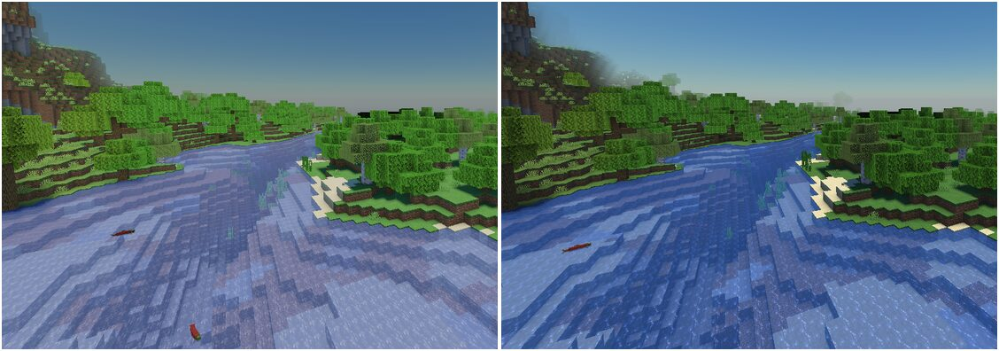
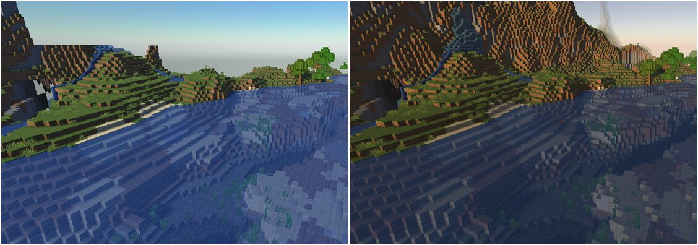
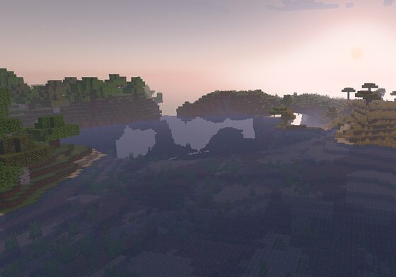

# Research: sun, sunset, colour and shadows, screenshot-based (Phases 1 and 2, done retroactively)

Requested by the user: every phase must start with screenshot research of the best packs, logged here.
Phases 1 and 2 were built without it, and the user correctly found the result "unsaturated, washed, cheap".
This is that missing research, done on 2026-10-21, with the fixes it led to (version 0.2.1).

## Method

- Full-resolution official gallery screenshots of Complementary Reimagined, BSL, Photon, Solas, Bliss,
  MakeUp Ultra Fast and Sildur's Vibrant (Modrinth). Studied for the look only; images not stored here.
- The same statistics computed on reference shots, on the user's own Aurum screenshots, and on headless test
  renders ("look lab": fixed scenes, fixed times, `scratchpad/tools/stats.py`):
  - **L**: mean lightness; **contrast**: its spread; **p5 / p95**: darkest and brightest 5%;
  - **sat**: mean saturation; **warm**: mean red minus blue (positive = warm frame).

## Finding 1: daytime. Too much colour, too little light range

| | User's 0.2.0 screenshots | References, daytime (BSL, Photon, Complementary, MakeUp) |
| --- | --- | --- |
| Saturation | 0.42 - 0.53 | **0.20 - 0.41** |
| Contrast | 0.12 - 0.16 | **0.15 - 0.24** |
| Brightest 5% | 0.61 - 0.65 | **0.69 - 0.86** |
| Darkest 5% | 0.14 - 0.22 | 0.10 - 0.21 |

Not a lack of colour: **sunlit surfaces never got bright** and everything sat in a narrow mid band, evenly
saturated. That is what reads as washed and cheap. The good packs keep colour restrained and let the sun hit.

Root cause: the log-space filmic curve was anchored on 18% grey (camera practice). Minecraft textures are dark
in linear light, so a sunlit grass top (about 0.3 linear) landed at 0.62 on screen no matter the exposure.

Fix (0.2.1): tone curve **exactly linear through the mid-tones** (texture colours stay true, as in vanilla), soft
shoulder only above 0.6; exposure re-anchored so a noon-lit surface is ~1.2x its texture; separate sky gain;
less sky fill light so shade falls off; vibrance boost removed.

Lab result, same scenes: contrast 0.10 -> 0.15-0.16, brightest 5% 0.56 -> 0.70, saturation down to the reference range.

## Finding 2: golden hour. The whole frame is warm, and the haze glows

Ten sunset/sunrise reference shots:

| | References | Aurum 0.2.0 |
| --- | --- | --- |
| Frame warmth (red minus blue) | **+0.09 to +0.49, every shot** | -0.09 to +0.03 |
| Sky away from the sun | peach, pink, lavender | blue-grey |
| Haze toward the sun | glowing gold | grey (sun glow excluded on purpose) |
| Around the sun | big soft warm glow, often bloom and god rays | small hard disc |

Physics gives nearly neutral light until the sun is almost down; the packs exaggerate golden hour on purpose.

Fix (0.2.1): an intentional golden-hour grade from ~25 degrees down (scaled by the Sunset slider): amber sunlight,
peach light in the shade, peach-pink-lavender upper sky, sunlight scattered into the haze toward the sun, and a
wide warm glow around the disc. Golden-hour exposure lifts a little.

Also found: Minecraft's sun eases, so tick != angle. Golden hour (15 to 2 degrees) is ticks ~11800-12700.

Still missing vs the references (honest gap): **bloom on the sun and bright surfaces, and god rays** appear in
almost every great golden-hour shot. They are Phase 4 in the plan; moving them earlier is proposed to the user.

## Finding 3: shadows (user report on 0.2.0 + references)

- References: soft, filtered shadows everywhere; long at golden hour but never crossing the whole view.
- User saw shadows **visibly step every second**. Cause: at low sun a small angle step moves a tall object's
  shadow tip many blocks (a 100-block tower at 10 degrees: ~13 blocks per 0.23 degree step).
  Fix: smaller steps (0.14 degrees) and a 0.45 s cross-fade from the previous map after every rebuild (third map
  kept for it); light colours also ease over 0.4 s. Lossless frame capture confirms no stepping at the shadow edge.
- User saw **very long shadows**. Physically correct for a low sun, but past ~6x height they read as a glitch.
  Fix: shadows stop lengthening below ~10 degrees and fade out between ~5 and ~11 degrees.

## Finding 4: horizon at dusk (user report)

A navy band under the orange horizon: the below-horizon colour used the sky 2 degrees up, which at dusk is
blue-grey. Fix: it now blends horizon and haze, so a sunset horizon fades into warm dusk.

## Process from here on

Every phase begins with: reference screenshots (gallery + community), the same statistics, a written target
("contrast 0.15-0.24, brightest 5% 0.7-0.9, warm +0.1..+0.4 at golden hour"), then the build, then a look-lab
comparison logged in `docs/research/`.
