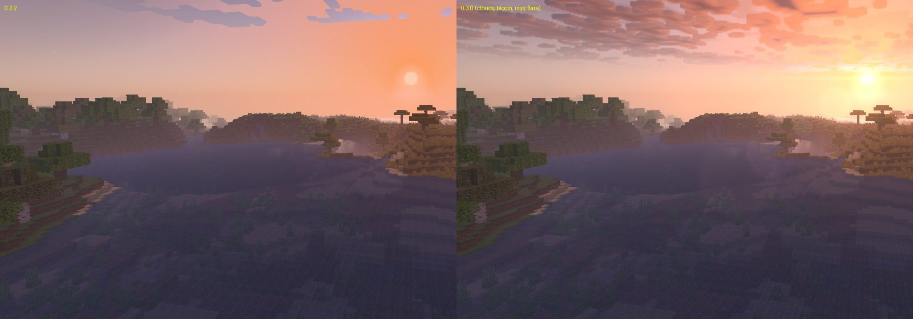
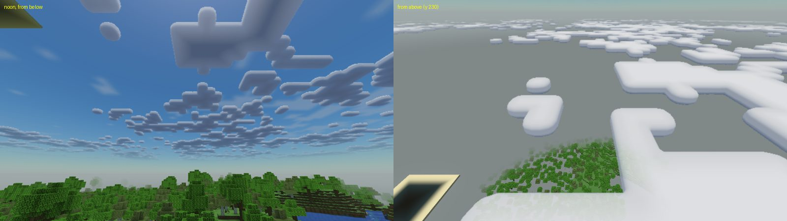
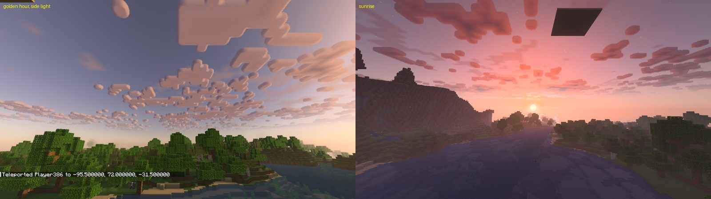

# Research: clouds, god rays, bloom and lens flare (screenshot-based)

Done 2026-10-21 before building the sky-extras phase (spec Phase 4, moved ahead of water at the user's request).
Same method as `LOOK_PHASE1_2.md`. We downloaded official full-resolution gallery screenshots from Modrinth and
studied them for the look only. We did not read any code, and the images are not stored here.

References:

| Pack | Why it is here |
| --- | --- |
| [Nostalgia Shader](https://modrinth.com/shader/nostalgia-shader) | Story Mode-like clouds: rounded blocky slabs, pink at sunset (closest to what the user asked for) |
| [Story Mode Clouds](https://modrinth.com/resourcepack/story-mode-clouds) | Story Mode cloud look in vanilla: soft gradient slabs |
| [Gradient Clouds](https://modrinth.com/resourcepack/gradient-clouds) | Transparent vertical gradient, Story Mode style |
| [Better Clouds](https://modrinth.com/mod/better-clouds) | Many soft layered clouds, sunset colouring |
| Complementary, BSL, Sildur's, Solas, Photon (earlier gallery) | Bloom on the sun, god rays |

## Finding 1: Story Mode clouds are rounded blocks, lit, never grey

The Nostalgia shots (the closest match to the user's request) and the Story Mode packs show the following.

- **Shape:** the vanilla cloud layout (large flat 12-block cells) with **rounded corners and edges**. They stay
  blocky and Minecraft-like, with nothing "realistic" about them.
- **Layering:** clouds come at more than one height and size, and the far ones fade into the sky haze. That
  depth is what reads as "layered".
- **Shading:** a bright top, a slightly darker lavender belly, and soft sides. There are no black or grey
  undersides in daylight.
- **Colour, measured** (k-means clusters on the sky half, 8-bit sRGB):

| Scene | Cloud body | Cloud highlight | Sky behind |
| --- | --- | --- | --- |
| Noon (Nostalgia 0, 4) | (127,133,168) to (132,155,179) | (180-182, 176-190, 196-204), lavender-white | (72-96, 103-133, 152-167) |
| Golden hour (Nostalgia 6) | (195,131,134) mauve-pink | (224,165,158) peach | (160,102,113) |
| Dusk (Nostalgia 5, 7) | (128-155, 101-142, 136-172) | (162-188, 122-167, 150-184) | lilac |

  The clouds are about **1.3 to 1.5 times brighter than the sky** behind them, and the highlights stay below
  white (about 0.75 lightness). The belly has a cool tint at noon and a pink tint at golden hour.

**Targets:** the cloud highlight should come out at 1.3 to 1.5 times sky lightness. At noon the belly should
be lavender with blue over red by about 0.1. At golden hour the tops should be peach and the bodies mauve-pink
(red/green about 1.35, blue ≥ green).

## Finding 2: bloom makes the sun big and soft

Radial lightness profile around the sun. The radius is a fraction of screen height, and the median is taken
on each ring.

| | r = 0.01 | 0.04 | 0.08 | 0.16 | 0.32 |
| --- | --- | --- | --- | --- | --- |
| Complementary 0 | 1.00 | 1.00 | 0.95 | 0.90 | 0.77 |
| Solas 2 | 0.99 | 0.95 | 0.87 | 0.65 | 0.56 |
| Photon 0 | 0.98 | 0.78 | 0.75 | 0.72 | 0.53 |
| **Aurum 0.2.2 (savanna sunset)** | 0.93 | 0.71 | 0.66 | 0.46 | 0.36 |

In the references the sun's white core holds out to about 0.04 to 0.08 of screen height, then falls slowly.
Ours drops right after the disc.

**Target:** at golden hour, lightness should be at least 0.85 at r = 0.04 and about 0.75 at r = 0.08. Bloom
must stay subtle elsewhere: a sunlit block face does not bloom, while lava, glowstone and the sun do. This is
spec feature 6 ("no glowing haze over the whole screen").

## Finding 3: god rays are dark shafts as much as bright ones

- In Complementary 0, Solas 2 and Sildur's 3, the rays are visible only where something breaks the sun: trees,
  terrain edges, cloud gaps. Over open sky they just widen the glow.
- The rays are warm (the sun glow colour) and fade within about 0.3 to 0.5 of the screen height from the sun.
- In haze (Solas 2) the rays are stronger. At clear noon (Sildur's 0) there are none.

**Design:** follow GPU Gems 3, chapter 13.

1. Build an occlusion mask of open sky at 1/4 resolution, from depth with cloud alpha removed. That also gives
   rays through gaps in the clouds.
2. Apply a radial blur toward the sun with 16 jittered samples.
3. Weight the strength by golden hour and the fog director's haze, and fade it as the sun leaves the screen or
   goes behind the camera.

## Finding 4: lens flare is optional in the references; keep it small

- None of the gallery shots have a big lens flare. BSL has a small diamond sun, and Sildur's has a faint ghost
  or two.
- The user explicitly wants a flare (spec P1), so it will be subtle:
  - a soft warm halo,
  - three or four faint coloured ghosts along the axis through the centre of the screen,
  - a short horizontal streak.
- **Occlusion:** a small GPU pass reads the depth and cloud alpha in a 4×4 pattern around the sun into a 1×1
  texture, blended over time. The composite reads that texel directly, so the CPU never waits (spec feature 8).

## What we build (and the cost plan for the UHD 620 at 1080p)

| Pass | Resolution | Work | Budget |
| --- | --- | --- | --- |
| Clouds | 1/2 | Sphere-traced rounded slabs from a baked distance field of the vanilla cloud texture, plus a higher thin layer | ≤ 1 ms |
| Rays mask + blur | 1/4 | 1 + 16 samples | ≤ 0.3 ms |
| Bloom chain | 1/4 → 1/32 | 4 down, 3 up | ≤ 0.5 ms (Medium+ by spec) |
| Flare occlusion | 1×1 | 16 depth taps | ~0 |
| Composite | full | Adds clouds, rays, bloom and flare to the existing fog and grade pass | +0.2 ms |

- **Cloud shape:** taken from Minecraft's own `clouds.png`, so resource packs that change cloud shapes still
  work. Each pixel of that texture is 12 blocks, as in vanilla, and the clouds drift east at vanilla speed.
- **Cloud height:** vanilla's (y = 192, or the dimension's value).
- **Weather:** clouds thicken and grey in rain.
- **Turning clouds off:** the vanilla Clouds option still works. "Off" turns Aurum clouds off as well.

## Result (0.3.0, look lab: headless renders, same scenes and times as before)

| Golden-hour lab | 0.2.2 | 0.3.0 | References |
| --- | --- | --- | --- |
| Brightest 5% (p95) | 0.73 - 0.79 | **0.78 - 0.90** | 0.69 - 0.86 |
| Frame warmth | +0.01 to +0.08 | **+0.02 to +0.10** | +0.09 to +0.49 |
| Sun profile at r = 0.04 / 0.08 / 0.16 / 0.32 (facing the sun, 11 degrees) | 0.78 / 0.78 / 0.76 / 0.66 (effects off) | **0.98 / 0.96 / 0.88 / 0.77** | Complementary 1.00 / 0.95 / 0.90 / 0.77; Solas 0.99 / 0.87 / 0.65 / 0.56 |
| Clipped pixels | 0 % | 0.87 % | 0.48 - 1.32 % |

Contribution of each effect, measured with it switched off (same shot). The table gives screen lightness at
r = 0.04 and r = 0.16:

| | 0.04 | 0.16 |
| --- | --- | --- |
| All off | 0.78 | 0.76 |
| Bloom only (no rays), first build | 0.95 | 0.89 |
| Rays only (no bloom), first build | 0.86 | 0.82 |
| Everything, first build | 0.99 | 0.94 |
| **Everything, final** | **0.98** | **0.88** |

The first build was too wide (0.94 at r = 0.16, 4.4 % of pixels clipped). Bloom was then lowered to 0.25, its threshold raised to 0.85,
and the rays lowered to 0.30. The final profile is within 0.02 of Complementary's at every radius. Terrain
statistics did not change.

**Clouds:**

- The first build baked the distance field at the cloud texture's own resolution (12 blocks per texel). The
  shapes came out as smooth blobs, and the Minecraft block steps were lost.
- The fix bakes an exact distance transform at 4 sub-texels per cell (3 blocks), rounds only the outer corners
  (radius 3.6 blocks), and uses a 6-block slab with flat faces and edges rounded to 2 blocks.
- Seen from above, the result matches the Nostalgia references: big flat rounded slabs with the block layout
  intact.
- At golden hour the bodies come out peach and mauve-pink, matching the references. The first build was tan,
  and a golden-hour tint fixed that.

**Not verifiable here:** cost on the UHD 620 (llvmpipe timings mean nothing), and shimmer in motion at
half resolution. Both are on the user's test sheet.
